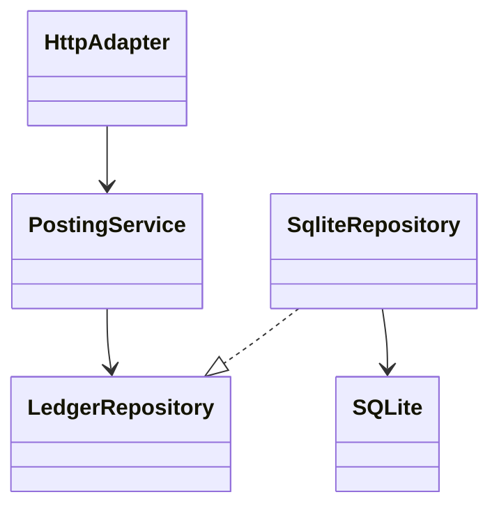
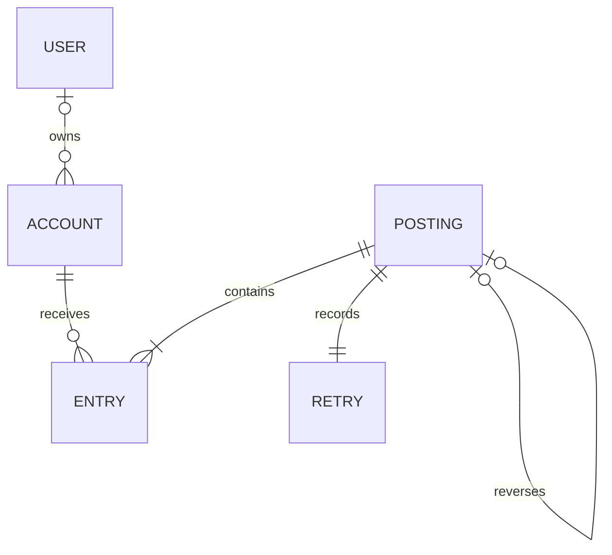
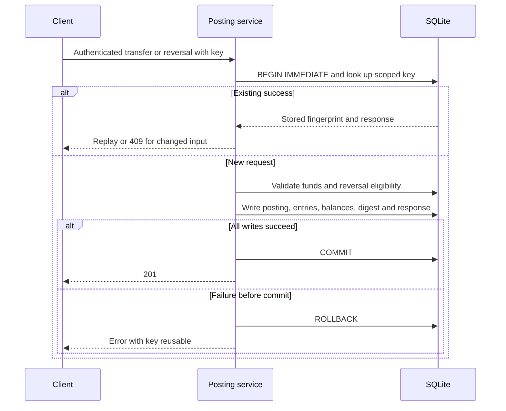

# Stage 2 design

The OpenAPI contract specifies the nine routes, request shapes, success bodies and roles. Only GET /health is scheduled for implementation in this stage. The remaining eight operations are specified for later stages.

## ADR 1 — HTTP boundary and identity

Use Java 21 with Spring Boot 3.5.9. Its dependency management pins Spring MVC 6.2.15, Tomcat 10.1.50, Jackson 2.19.4 and Xerial SQLite JDBC 3.49.1.0. The adapter owns request validation, the posting service owns accounting rules, and a repository interface owns one connection per transaction. See [[knowledge-provenance]] and the bearer-ownership and http-outcomes notes.

IR-1–3: bind to loopback (default 127.0.0.1:8000). Read LEDGER_ADMIN_TOKEN at startup and reject a missing or short secret with a sanitized error. For the SQLite implementation, accept a local data path, initialize the schema and restrict the directory and database, WAL and SHM files to the operator.

IR-4–8: public registration returns a UUID and a once-visible user token derived from 32 secure random bytes. Store its digest. Authenticate the bearer before owner/admin decisions. Parse one UTF-8 JSON object, reject duplicate keys, unknown or missing fields, malformed UUIDs, query strings and GET bodies. Enforce the 16,384-byte limit while reading. Reject unsupported media types with 415, chunking with 411 and oversized bodies with 413. Tomcat enforces wire framing before MVC. Verify connector-level failures over real sockets and supply a sanitized container error handler where MVC is bypassed. Return JSON with no-store and nosniff. Use 400 for invalid input, 401 for invalid identity, 403 for wrong role/owner, 404 for unknown route/resource, 405 with Allow for wrong method, 409 for state conflicts, 500 for internal failure. Never log credentials.

IR-9–11: accept exactly one visible-ASCII retry key of 1–128 characters for money-changing calls. Return the original status/body plus a replay header. Budget five seconds cumulatively for write-lock waiting, then roll back and return 503 busy. Set idle/request-read timeout to 15 seconds and verify the SRS five-second tolerance independent of database duration.

## ADR 2 — SQLite and balanced postings

Use WAL on a local disk, foreign_keys=ON on each connection, synchronous=FULL and BEGIN IMMEDIATE before the funds check. Compute each busy wait from the remaining monotonic five-second budget. Successful response publication follows commit. Owner-only reads use a committed snapshot. See [[knowledge-provenance]], posting-transaction and writer-contention.

| Relation | Keys, relationships and enforcement |
| --- | --- |
| users | UUID primary key, unique token digest, validated name |
| accounts | UUID primary key, nullable owner FK, currency, signed integer balance. Unique owner/currency for wallets, unique currency for ownerless clearing accounts. CHECK nonnegative user balance. |
| postings | UUID primary key, unique increasing sequence, currency, positive amount, UTC timestamp, kind, optional unique original-posting FK and digest. |
| entries | Posting FK, account FK, side, positive amount. Primary key (posting, side). Transaction boundary inserts exactly two entries and verifies equal amount, distinct accounts and matching currency before commit. Index account and posting for ordered history. |
| retries | Primary key (caller, operation, key), normalized fingerprint, posting FK, exact response bytes and HTTP status. Persist within posting transaction. |

Use strict integer storage and checked Java arithmetic, with BigInteger for wider reconciliation sums. Each posting debits and credits equal integer minor units in one currency. Funding debits that currency’s clearing account. Triggers reject updates/deletes to postings, entries and successful retries. A reversal appends an inverse pair; reject a spent recipient, second reversal and reversal of a reversal.

## ADR 3 — Replay, integrity and recovery

Canonical retry input is UTF-8 compact JSON with fixed keys in lexical order, normalized lowercase UUID strings and base-ten integer amounts. Include the operation and every validated parameter (including reversal target). SHA-256 that byte sequence. Scope lookup by caller, operation and key. See [[knowledge-provenance]], retry-identity, digest-continuity and snapshot-recovery.

For the posting chain encode a JSON array in fixed order: version 1, previous lowercase hex digest, sequence, posting UUID, UTC timestamp formatted with exactly three fractional digits and Z, kind, currency, amount, original UUID or null, then debit and credit arrays each containing account UUID and amount. Use compact UTF-8 JSON, canonical UUIDs and exact decimal integers. First previous digest is 64 zeroes. Compare recomputed digests and sequence continuity during reconciliation. A separately trusted head would be required to detect valid suffix removal.

Walkthrough: fund A with 10,000 paise and transfer 3,000 to B. An identical retry returns the saved body and leaves A at 7,000. Two later requests for 5,000 serialize: the first commits, the second observes 2,000 and fails for insufficient funds. A failure after the debit rolls the entire posting back; losing the HTTP response after commit instead permits replay. Reconcile all accounts including clearing on one read snapshot, verify references, reversal links, per-currency totals and chain independently of cached balances. Report discrepancies with HTTP 200 and ok=false. Restore a consistent SQLite backup into an isolated directory, reconcile, then replay a saved success to test both balances and retry persistence.
